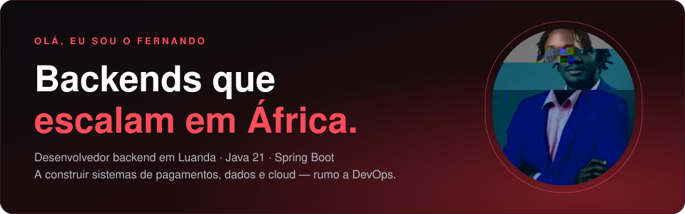
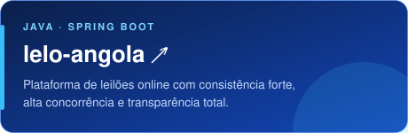
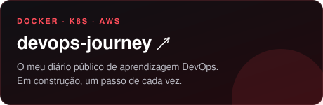
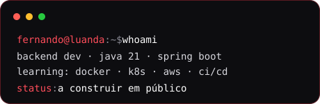

## Projectos para explorar

<table>
<tr>
<td width="50%"></td>
<td width="50%"></td>
</tr>
<tr>
<td width="50%"></td>
<td width="50%"></td>
</tr>
<tr>
<td width="50%"></td>
<td width="50%"></td>
</tr>
</table>

## Quem sou

<table>
<tr>
<td width="50%"></td>
<td width="50%">

- 🎯 **Objectivo:** transição para DevOps em 18 meses
- 🔭 **A estudar:** Docker, Kubernetes, AWS, observabilidade, CI/CD
- 🛠️ **A construir:** pagamentos, leilões, notificações e plataformas de dados
- 🌍 **Foco:** produtos que resolvem problemas reais em Angola

</td>
</tr>
</table>

Se algum projecto te for útil, deixa uma ⭐. Obrigado pela visita!

