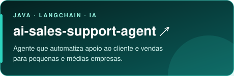
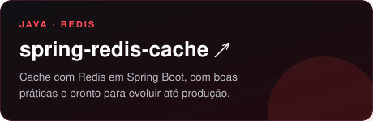

## 👋 Olá, eu sou o Fernando

Sou apaixonado por tecnologia e por construir sistemas que resolvem problemas reais. Trabalho como **desenvolvedor backend em Luanda**, com **Java 21 e Spring Boot**, e gosto de APIs bem desenhadas, mensageria, cache e tudo o que ajuda um sistema a aguentar carga a sério.

Neste momento estou a fazer a transição para **DevOps**: Docker, Kubernetes, AWS, observabilidade e CI/CD. Quero documentar o caminho em público e partilhar o que aprendo pelo caminho.

Estou sempre aberto a aprender coisas novas, trabalhar em equipa e discutir ideias. Se quiseres conversar, escreve-me para **fernandoangolar581@gmail.com**.

<table>
<tr>
<td width="55%"></td>
<td>

### Onde me encontrar

- 💼 [LinkedIn](https://www.linkedin.com/in/fernando-angolar-692a0423a)
- 📬 [Enviar email](mailto:fernandoangolar581@gmail.com)
- 🏢 [Organização Wundu](https://github.com/WUNDU)
- 🧪 [devops-journey](https://github.com/fernando-angolar/devops-journey) — o meu diário de DevOps

</td>
</tr>
</table>

## 🧰 Tecnologias

## 🚀 Projectos em destaque

## 📊 Estatísticas

