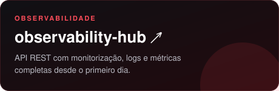

 

## 🚀 Projectos em destaque

## 🧰 Stack

## 👤 Quem sou

- 🎯 **Objectivo:** transição para DevOps em 18 meses
- 🔭 **A estudar:** Docker, Kubernetes, AWS, observabilidade e CI/CD
- 🛠️ **A construir:** pagamentos, leilões, notificações e plataformas de dados
- 🌍 **Foco:** produtos que resolvem problemas reais em Angola

⭐ Se algum projecto te for útil, deixa uma estrela. Obrigado pela visita!

